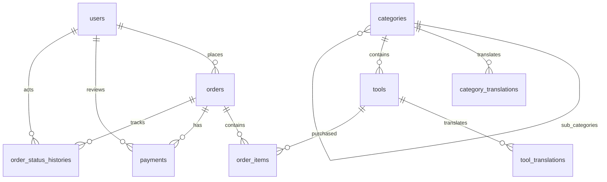

# WEBSITE BÁN TOOL ĐÓNG GÓI (PACKAGED SOFTWARE E-COMMERCE)

> **Phiên bản:** 1.1 (MVP)  
> **Kiến trúc hệ thống:** Monolithic Modular Backend + Feature-based Next.js Frontend + PostgreSQL (Prisma ORM)  
> **Mô hình thanh toán:** Bán tự động (Chuyển khoản Ngân hàng & USDT TRC20 -> Admin đối soát thực tế & Bàn giao Key thủ công)

---

## 📌 MỤC LỤC
1. [Giới Thiệu Dự Án](#1-giới-thiệu-dự-án)
2. [Nguyên Tắc Thiết Kế Cốt Lõi](#2-nguyên-tắc-thiết-kế-cốt-lõi)
3. [Công Nghệ Sử Dụng (Tech Stack)](#3-công-nghệ-sử-dụng-tech-stack)
4. [Kiến Trúc Hệ Thống & Sơ Đồ Luồng](#4-kiến-trúc-hệ-thống--sơ-đồ-luồng)
5. [Cấu Trúc Thư Mục Toàn Dự Án](#5-cấu-trúc-thư-mục-toàn-dự-án)
6. [Thiết Kế Cơ Sở Dữ Liệu (Database Schema)](#6-thiết-kế-cơ-sở-dữ-liệu-database-schema)
7. [Luồng Nghiệp Vụ & Máy Trạng Thái (State Machine)](#7-luồng-nghiệp-vụ--máy-trạng-thái-state-machine)
8. [Quy Chuẩn Thanh Toán (Ngân Hàng & USDT TRC20)](#8-quy-chuẩn-thanh-toán-ngân-hàng--usdt-trc20)
9. [Danh Sách RESTful API Chi Tiết](#9-danh-sách-restful-api-chi-tiết)
10. [An Toàn Thông Tin & Bảo Mật](#10-an-toàn-thông-tin--bảo-mật)
11. [Kế Hoạch & Lộ Trình Triển Khai (8 Giai Đoạn)](#11-kế-hoạch--lộ-trình-triển-khai-8-giai-đoạn)
12. [Hướng Dẫn Cài Đặt & Chạy Thử Nghiệm](#12-hướng-dẫn-cài-đặt--chạy-thử-nghiệm)
13. [Kịch Bản Kiểm Thử Nghiệp Vụ (QA Checklist)](#13-kịch-bản-kiểm-thử-nghiệp-vụ-qa-checklist)

---

## 1. GIỚI THIỆU DỰ ÁN

Hệ thống sàn thương mại điện tử chuyên cung cấp các phần mềm, công cụ MMO / Marketing đóng gói sẵn:
- **Dành cho khách hàng:** Đăng ký/đăng nhập, tìm kiếm công cụ theo danh mục đa ngôn ngữ (VI/EN), xem chi tiết giá và tính năng, tạo đơn mua, thanh toán chuyển khoản nội địa hoặc USDT TRC20, nhập TxID/ảnh hóa đơn, nhận mã kích hoạt (license key) và tài liệu hướng dẫn an toàn trong tài khoản.
- **Dành cho quản trị viên (Admin):** Quản lý người dùng, quản trị danh mục và sản phẩm (giá, ảnh, bản dịch), giám sát danh sách đơn hàng, trực tiếp tra cứu và đối soát giao dịch ngân hàng / blockchain (TRONSCAN), phê duyệt hoặc từ chối đơn hàng, bàn giao key bản quyền cho khách.

---

## 2. NGUYÊN TẮC THIẾT KẾ CỐT LÕI

- **Zero-Trust Client Pricing:** Tuyệt đối không chấp nhận giá tiền, tỷ giá hay trạng thái đơn hàng do Frontend gửi lên. Toàn bộ phép tính tổng tiền, snapshot giá và chốt tỷ giá USDT phải thực hiện ở Backend thông qua Database.
- **Snapshot Data Preservation:** Mọi đơn hàng (`orders` & `order_items`) phải chụp lại tên sản phẩm, đơn giá tại thời điểm đặt để việc thay đổi giá hay sửa tool sau này không làm sai lệch sổ sách kế toán.
- **Idempotency & Anti-Duplicate:** Chống trùng mã giao dịch TxID, chống việc xác nhận thanh toán 2 lần (double-spending / race condition) bằng Database Transaction và khóa bản ghi.
- **Modular Monolith & Feature-based Architecture:** 
  - Backend: Tách rõ Route, Controller, Service, Schema, Types theo từng module nghiệp vụ.
  - Frontend: Tách theo Feature (`feature/customer`, `feature/admin`, `feature/auth`), giữ App Router mỏng và chỉ làm nhiệm vụ kết nối layout & routing.
- **Audit Trails:** Mọi bước chuyển trạng thái đơn hàng đều phải ghi nhận log vào bảng `order_status_histories` kèm định danh người thực hiện (`actor_id`) và lý do.

---

## 3. CÔNG NGHỆ SỬ DỤNG (TECH STACK)

### Frontend
- **Framework:** Next.js (App Router, React 19 / 18, TypeScript)
- **Styling:** Tailwind CSS, Lucide React Icons
- **State & Form:** React Hook Form + Zod Resolver
- **HTTP Client:** Axios (Interceptors xử lý refresh token / base URL)
- **Tiện ích:** `qrcode.react` (Sinh QR địa chỉ ví TRON), `i18n` (Hỗ trợ đa ngôn ngữ VI - EN)

### Backend
- **Runtime:** Node.js (LTS v20+) + TypeScript + `tsx` runner
- **Web Framework:** Express.js
- **ORM & Database:** Prisma ORM + PostgreSQL
- **Bảo mật:** `helmet`, `cors`, `cookie-parser`, `express-rate-limit`, `bcryptjs`, `jsonwebtoken`
- **Validation:** Zod (Request Body, Query, Params)
- **Xử lý Tệp Tin:** `multer` (MemoryStorage) + `sharp` (Tái mã hóa sang WebP chuẩn hóa bảo mật)

---

## 4. KIẾN TRÚC HỆ THỐNG & SƠ ĐỒ LUỒNG

### 4.1. Sơ đồ tương tác tổng thể
```text
                  +--------------------------------+
                  |  Customer / Admin Web Browser  |
                  +--------------------------------+
                                  |
                                  v
                  +--------------------------------+
                  |    Next.js Frontend Client     |
                  |  (App Router + Feature-based)  |
                  +--------------------------------+
                                  |
                           HTTPS / REST API
                                  |
                                  v
                  +--------------------------------+
                  |    Express.js Backend API      |
                  |  (Auth, Validate, Rate-limit)  |
                  +--------------------------------+
                                  |
          +-------------+---------+---------+--------------+
          |             |                   |              |
          v             v                   v              v
     Auth Module   Tools Module       Orders Module  Payments Module
          |             |                   |              |
          +-------------+---------+---------+--------------+
                                  |
                              Prisma ORM
                                  |
                                  v
                       PostgreSQL Database
```

### 4.2. Luồng đặt hàng & thanh toán
```text
Khách hàng chọn Tool -> Backend tính tổng tiền -> Tạo Order (PENDING_PAYMENT)
       |
       +--> Chọn hình thức thanh toán (Ngân hàng / USDT TRC20)
       |
       +--> Backend sinh Payment record & chốt số tiền cần chuyển
       |
       +--> Khách chuyển tiền & gửi TxID / ảnh hóa đơn -> Payment (SUBMITTED)
       |
       +--> Admin tra cứu App Ngân hàng hoặc TRONSCAN
       |        |
       |        +-- [Không hợp lệ] --> Admin từ chối (REJECTED) -> Ghi lý do
       |        |
       |        +-- [Hợp lệ] --------> Admin duyệt (CONFIRMED) -> Order (PAID / PROCESSING)
       |
       +--> Admin nhập Key và Hướng dẫn sử dụng -> Order (COMPLETED)
       |
       +--> Khách hàng truy cập tài khoản nhận Key & hướng dẫn
```

---

## 5. CẤU TRÚC THƯ MỤC TOÀN DỰ ÁN

```text
web-ban-tool/
├── back-end/
│   ├── prisma/
│   │   ├── schema.prisma            # Schema 9 bảng chuẩn MVP
│   │   ├── seed.ts                  # Seed Admin, danh mục & công cụ mẫu
│   │   └── migrations/              # Lịch sử migration Prisma
│   ├── src/
│   │   ├── config/                  # database.ts, env.ts (Zod env check)
│   │   ├── constants/               # enum, roles, order & payment status
│   │   ├── middlewares/             # auth, role, error, rate-limit, upload, validate
│   │   ├── modules/
│   │   │   ├── auth/                # Đăng ký, đăng nhập, hồ sơ cá nhân
│   │   │   ├── users/               # Quản lý tài khoản
│   │   │   ├── categories/          # Danh mục & bản dịch đa ngôn ngữ
│   │   │   ├── tools/               # Công cụ, giá, ảnh & bản dịch
│   │   │   ├── orders/              # Quản lý giỏ, tạo đơn, lịch sử đơn
│   │   │   ├── payments/            # Khởi tạo thanh toán, gửi TxID, upload bill
│   │   │   └── admin/               # API đối soát, duyệt đơn, xuất key
│   │   ├── utils/                   # apiError, apiResponse, jwt, fileUpload
│   │   ├── app.ts                   # Cấu hình Express middleware
│   │   └── server.ts                # Bootstrap server & Graceful shutdown
│   ├── uploads/proofs/              # Nơi lưu ảnh minh chứng (đã chuẩn hóa WebP)
│   ├── .env.example
│   ├── package.json
│   └── tsconfig.json
│
├── front-end/                       # Khởi tạo bằng Next.js App Router
│   ├── public/                      # Static assets, logo, icons
│   ├── src/
│   │   ├── app/                     # Next.js App Router
│   │   │   ├── (store)/             # Layout giao diện khách hàng (trang chủ, tools, orders)
│   │   │   ├── (auth)/              # Layout xác thực (login, register)
│   │   │   ├── admin/               # Layout quản trị Admin (dashboard, orders, tools, payments)
│   │   │   └── layout.tsx           # Root layout
│   │   ├── feature/                 # Feature-based business logic
│   │   │   ├── auth/                # Login, Register, Session components, hooks, services
│   │   │   ├── customer/            # Home, Tools, Orders, Payments, Profile features
│   │   │   └── admin/               # Dashboard, Tools, Categories, Orders, Payments features
│   │   ├── components/              # Shared reusable components
│   │   │   ├── ui/                  # Button, Input, Modal, Select, Table
│   │   │   ├── shared/              # Loading, EmptyState, ErrorMessage
│   │   │   └── layout/              # Header, Footer, AdminSidebar
│   │   ├── lib/                     # axios.ts, utils.ts, constants.ts
│   │   └── locales/                 # vi/ & en/ json translation dictionary
│   ├── package.json
│   └── tsconfig.json
│
└── .agent/skills/                   # Các bộ kỹ năng hướng dẫn tự động hóa phát triển
    ├── tool-store-backend-dev/      # Chuẩn phát triển module Backend
    ├── tool-store-frontend-feature-dev/ # Chuẩn phát triển Feature Frontend
    ├── tool-store-payment-crypto-bank/  # Quy chuẩn thanh toán & bảo mật TxID/Bill
    ├── tool-store-ui-design-system/     # Quy chuẩn UI/UX Clean, Responsive, Zero-Lag (Stitch AutoTool.dev)
    └── tool-store-workflow-checklist/   # Checklist 8 giai đoạn & kịch bản QA
```

---

## 6. THIẾT KẾ CƠ SỞ DỮ LIỆU (DATABASE SCHEMA)

Gồm 9 bảng cốt lõi phục vụ trọn vẹn mô hình MVP:



### Danh sách các bảng chi tiết
1. **`users`**: Quản lý tài khoản khách và quản trị (`id`, `email`, `password_hash`, `role: USER|ADMIN`, `status: ACTIVE|DISABLED`, `created_at`, `updated_at`).
2. **`categories`**: Danh mục phân cấp (`id`, `parent_id`, `is_active`, `sort_order`, `created_at`).
3. **`category_translations`**: Bản dịch danh mục (`id`, `category_id`, `locale: vi|en`, `name`, `slug`). Unique: `(category_id, locale)`.
4. **`tools`**: Công cụ đóng gói (`id`, `category_id`, `price` (Decimal), `currency: USD|VND`, `is_active`, `created_at`).
5. **`tool_translations`**: Bản dịch công cụ (`id`, `tool_id`, `locale: vi|en`, `name`, `slug`, `description`, `content` Text). Unique: `(tool_id, locale)`.
6. **`orders`**: Đơn hàng (`id`, `order_code` Unique, `user_id`, `status: PENDING_PAYMENT|PAID|PROCESSING|COMPLETED|CANCELLED|REFUNDED`, `total_amount` Decimal, `currency`, `key_delivered` Text, `instructions_delivered` Text, `paid_at`, `created_at`).
7. **`order_items`**: Chi tiết sản phẩm snapshot (`id`, `order_id`, `tool_id`, `tool_name_snapshot`, `unit_price` Decimal, `quantity`, `line_total` Decimal).
8. **`payments`**: Bản ghi thanh toán (`id`, `order_id`, `method: BANK_TRANSFER|USDT_TRC20`, `status: PENDING|SUBMITTED|CONFIRMED|REJECTED`, `currency`, `amount` Decimal, `exchange_rate` Decimal, `receive_address`, `network: TRC20`, `transaction_reference` TxID, `proof_image_url`, `rejection_reason`, `reviewed_by`, `reviewed_at`).
9. **`order_status_histories`**: Lịch sử chuyển trạng thái (`id`, `order_id`, `actor_id`, `from_status`, `to_status`, `note`, `created_at`).

---

## 7. LUỒNG NGHIỆP VỤ & MÁY TRẠNG THÁI (STATE MACHINE)

### 7.1. Trạng thái Đơn hàng (`orders.status`)
- `PENDING_PAYMENT`: Vừa tạo đơn, chờ khách hoàn tất chuyển tiền và gửi bill/TxID.
- `PAID`: Admin đã đối soát thành công tiền về tài khoản hoặc blockchain.
- `PROCESSING`: Đang chuẩn bị bản quyền, setup cấu hình hoặc đóng gói key.
- `COMPLETED`: Đã nhập mã bản quyền + tài liệu hướng dẫn giao cho khách hàng.
- `CANCELLED`: Đơn bị hủy do khách yêu cầu hoặc quá hạn không thanh toán.
- `REFUNDED`: Đã hoàn tiền cho khách hàng.

### 7.2. Trạng thái Thanh toán (`payments.status`)
```text
           [Khách tạo Payment]
                   |
                   v
               PENDING
                   |
           [Khách nộp TxID / Bill]
                   |
                   v
               SUBMITTED
                   |
         +---------+---------+
         |                   |
[Admin xác nhận]    [Admin từ chối]
         |                   |
         v                   v
     CONFIRMED            REJECTED
```

---

## 8. QUY CHUẨN THANH TOÁN (NGÂN HÀNG & USDT TRC20)

### 8.1. Chuyển khoản Ngân hàng (Nội địa)
- Khách hàng xem số tài khoản nhận, tên ngân hàng và số tiền chính xác kèm nội dung cú pháp: `DH_<ORDER_CODE>`.
- Khách chuyển khoản qua ứng dụng Mobile Banking và tải ảnh biên lai chuyển khoản.
- Ảnh tải lên được xử lý bằng `sharp` để chống mã độc (chuyển đổi hoàn toàn sang WebP, loại bỏ metadata EXIF và lưu tên UUID ngẫu nhiên).
- Admin kiểm tra biến động số dư ngân hàng thực tế trước khi bấm "Xác nhận".

### 8.2. USDT TRC20 (TRON Network)
- **Token:** USDT (Mã hợp đồng: `TR7NHqjeKQxGTCi8q8ZY4pL8otSzgjLj6t` trên TRON Mainnet).
- **Địa chỉ nhận:** Ví lạnh / ví an toàn do chủ hệ thống kiểm soát được cấu hình qua ENV `USDT_TRON_RECEIVE_ADDRESS`.
- **Tỷ giá:** Được chốt cố định tại thời điểm tạo thanh toán (ví dụ: `1 USD = 1 USDT`). Backend lưu lại `amount` và `exchange_rate` chính thức vào database.
- **Mã QR Code:** Được sinh trực tiếp ở Frontend thông qua thư viện `qrcode.react` mã hóa chuỗi địa chỉ ví TRON nhận tiền.
- **Kiểm định TxID:**
  - Regex chuẩn TRON TxID: `/^[a-fA-F0-9]{64}$/`.
  - Kiểm tra tính duy nhất: TxID chưa từng được dùng cho bất kỳ bản ghi thanh toán nào trước đó.
- **Admin đối soát Blockchain:**
  - Tra cứu trực tiếp trên TRONSCAN (`https://tronscan.org/#/transaction/<TxID>`).
  - Kiểm tra: Trạng thái `SUCCESS`, mạng TRON Mainnet, loại token `Tether USD (USDT)`, địa chỉ nhận trùng khớp ví hệ thống, số lượng chuyển đủ hoặc thừa.

---

## 9. DANH SÁCH RESTFUL API CHI TIẾT

Base URL: `/api`

### 9.1. Auth API
| Method | Endpoint | Quyền | Chức năng |
|---|---|---|---|
| POST | `/api/auth/register` | Public | Đăng ký tài khoản người dùng mới |
| POST | `/api/auth/login` | Public | Đăng nhập và nhận JWT token |
| POST | `/api/auth/logout` | User | Đăng xuất, xóa session/cookie |
| GET | `/api/auth/me` | User | Lấy thông tin tài khoản hiện tại |

### 9.2. Customer API
| Method | Endpoint | Quyền | Chức năng |
|---|---|---|---|
| GET | `/api/categories` | Public | Lấy danh mục hỗ trợ lọc `?locale=vi` |
| GET | `/api/categories/:slug` | Public | Chi tiết danh mục kèm công cụ thuộc danh mục |
| GET | `/api/tools` | Public | Danh sách công cụ (`?page=1&limit=12&category=...&search=...&locale=vi`) |
| GET | `/api/tools/:slug` | Public | Xem thông tin chi tiết công cụ |
| POST | `/api/orders` | User | Tạo đơn hàng mới (tính giá từ Database) |
| GET | `/api/orders` | User | Lịch sử mua hàng của khách |
| GET | `/api/orders/:id` | User | Chi tiết đơn hàng và nhận License Key/hướng dẫn |
| POST | `/api/orders/:orderId/payments` | User | Khởi tạo phiên thanh toán (Bank / USDT TRC20) |
| GET | `/api/payments/:paymentId` | User | Xem thông tin địa chỉ ví/tài khoản và QR |
| POST | `/api/payments/:paymentId/submit` | User | Gửi mã giao dịch TxID |
| POST | `/api/payments/:paymentId/proof` | User | Tải ảnh hóa đơn chuyển khoản (Multipart/WebP) |

### 9.3. Admin API (Yêu cầu Token & Role: `ADMIN`)
| Method | Endpoint | Quyền | Chức năng |
|---|---|---|---|
| GET | `/api/admin/dashboard` | Admin | Thống kê doanh thu, đơn cần xử lý, tổng user |
| GET | `/api/admin/users` | Admin | Danh sách và quản lý người dùng |
| GET | `/api/admin/categories` | Admin | Quản trị danh mục |
| POST | `/api/admin/categories` | Admin | Thêm mới danh mục kèm đa ngôn ngữ |
| PATCH | `/api/admin/categories/:id` | Admin | Cập nhật danh mục và bản dịch |
| GET | `/api/admin/tools` | Admin | Quản lý danh sách công cụ |
| POST | `/api/admin/tools` | Admin | Đăng bán công cụ mới kèm bản dịch |
| PATCH | `/api/admin/tools/:id` | Admin | Cập nhật giá, thông tin, trạng thái công cụ |
| DELETE | `/api/admin/tools/:id` | Admin | Ẩn hoặc xóa mềm công cụ |
| GET | `/api/admin/orders` | Admin | Tra cứu và lọc toàn bộ đơn hàng |
| GET | `/api/admin/payments` | Admin | Danh sách giao dịch cần đối soát |
| POST | `/api/admin/payments/:id/confirm` | Admin | Xác nhận đã nhận tiền (Transaction) |
| POST | `/api/admin/payments/:id/reject` | Admin | Từ chối giao dịch kèm lý do ghi chú |
| POST | `/api/admin/orders/:id/complete` | Admin | Giao Key bản quyền và tài liệu sử dụng |

---

## 10. AN TOÀN THÔNG TIN & BẢO MẬT

1. **Bảo mật Mật khẩu & Token:** Mật khẩu hash bằng `bcryptjs` với salt round = 10; JWT lưu trữ qua HttpOnly Cookie hoặc Authorization Header với thời hạn thích hợp.
2. **Kiểm soát Tệp Tin Tải Lên (Sanitization):** Không bao giờ lưu file trực tiếp vào đĩa nếu chưa giải mã và chuẩn hóa lại pixel thông qua thư viện `sharp` sang định dạng `.webp`.
3. **Phòng chống Tấn Công Từ Chối Dịch Vụ & Brute-Force:** Kích hoạt `express-rate-limit` trên các endpoint nhạy cảm (`/api/auth/login`, `/api/payments/*/submit`).
4. **Kiểm soát Quyền Truy Cập (IDOR Protection):** Khách hàng chỉ có quyền xem và thao tác trên đơn hàng hoặc payment thuộc về chính `user_id` của họ.
5. **Bảo mật Địa Chỉ Ví & Khoá Riêng Tư:** Tuyệt đối không lưu trữ Private Key hay Mnemonic seed phrase của ví TRON trên server/database.

---

## 11. KẾ HOẠCH & LỘ TRÌNH TRIỂN KHAI (8 GIAI ĐOẠN)

- **Giai đoạn 1: Khởi tạo Kiến trúc** (Cấu hình repo, backend Express + TS, frontend Next.js App Router, thiết lập biến môi trường, Prisma Client).
- **Giai đoạn 2: Cơ sở dữ liệu & Migration** (Viết `schema.prisma` 9 bảng, migrate lên PostgreSQL, viết script `seed.ts` dữ liệu mẫu).
- **Giai đoạn 3: Authentication & Authorization** (Đăng ký, đăng nhập JWT, hash bcrypt, middlewares xác thực và phân quyền `Role.ADMIN`).
- **Giai đoạn 4: Quản trị Danh mục & Công cụ** (API CRUD Category & Tool đa ngôn ngữ VI/EN, upload ảnh WebP, giao diện trang chủ & chi tiết tool).
- **Giai đoạn 5: Đặt hàng & Snapshot Dữ liệu** (Logic tạo Order, kiểm tra sản phẩm `isActive`, chụp giá snapshot vào `order_items`).
- **Giai đoạn 6: Module Thanh toán & Đối soát** (Khởi tạo Payment, sinh QR TRC20, validate TxID chống trùng lặp, logic Admin duyệt giao dịch trong DB Transaction).
- **Giai đoạn 7: Bàn giao Key & Hoàn tất Đơn hàng** (Admin nhập Key/hướng dẫn gửi cho khách, khách truy cập trang tài khoản xem kết quả).
- **Giai đoạn 8: Hoàn thiện & Đóng gói Triển khai** (Kiểm thử tải, đối soát kịch bản edge-cases, đa ngôn ngữ i18n, build production, thiết lập Nginx & SSL).

---

## 12. HƯỚNG DẪN CÀI ĐẶT & CHẠY THỬ NGHIỆM

### 12.1. Cài đặt Backend
```bash
cd back-end

# 1. Cài đặt dependencies
npm install

# 2. Thiết lập biến môi trường
cp .env.example .env
# Chỉnh sửa chuỗi kết nối DATABASE_URL, JWT_SECRET, USDT_TRON_RECEIVE_ADDRESS

# 3. Đồng bộ Database qua Prisma
npx prisma generate
npx prisma db push

# 4. Nạp dữ liệu mẫu ban đầu
npm run prisma:seed

# 5. Khởi chạy ở chế độ phát triển
npm run dev
```

### 12.2. Cài đặt Frontend (Next.js)
```bash
cd front-end

# 1. Cài đặt dependencies
npm install

# 2. Cấu hình biến môi trường
# Tạo file .env.local:
# NEXT_PUBLIC_API_URL=http://localhost:5000/api

# 3. Khởi chạy dev server
npm run dev
```

---

## 13. KỊCH BẢN KIỂM THỬ NGHIỆP VỤ (QA CHECKLIST)

- [ ] **Auth:** Không cho phép đăng ký trùng email; Đăng nhập mật khẩu sai trả về 401; Người dùng thường không thể truy cập bất kỳ endpoint `/api/admin/*`.
- [ ] **Price Tampering:** Gửi body giả mạo `price` hoặc `total_amount` từ frontend -> Backend từ chối và tự tính lại giá từ database.
- [ ] **Inactive Tools:** Không cho phép tạo đơn với sản phẩm đang có cờ `is_active = false`.
- [ ] **TxID Validation:** Gửi TxID không đủ 64 ký tự hex -> Báo lỗi format; Gửi TxID đã tồn tại trong DB -> Báo lỗi trùng lặp.
- [ ] **Admin Double Approval:** 2 Admin cùng nhấn xác nhận 1 giao dịch -> Database transaction ngăn chặn cập nhật 2 lần.
- [ ] **License Key Privacy:** Khách hàng A không thể xem License Key thuộc về đơn hàng của khách hàng B.

